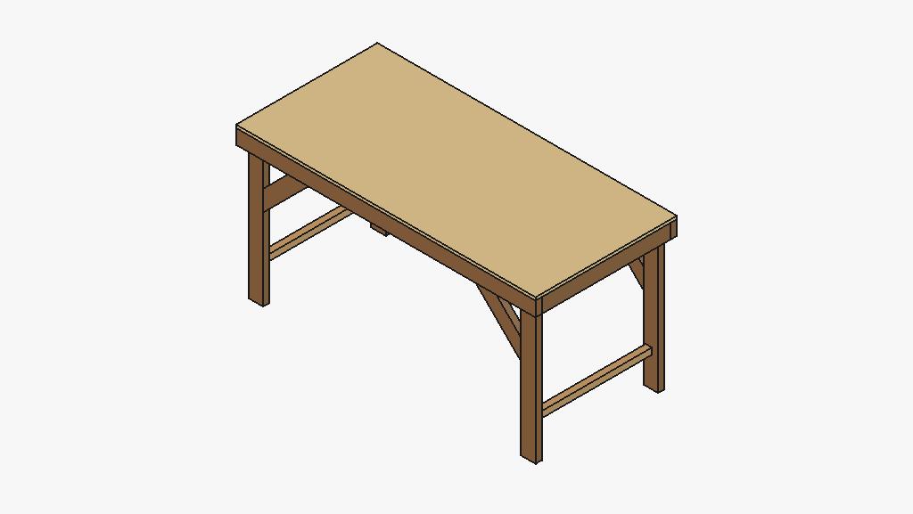

# desk_bench

A 72 x 34 in work desk, surface at 36-1/4 in, from lumber on hand: two 72 in
2x4s are the front and back rails, the other two are cut in half for four
35-1/2 in legs, the four 31 in 2x4s are two end rails and two joists, four
45 deg braces stiffen the legs along the bench, one 2x2 makes two foot rails.
A 23/32 in plywood top (one 4 x 8 sheet) is the only thing to buy, plus screws.
Replaces the tote bench's hutch and tote bays with a plain desktop.



## Status

`STATUS` is `concept`. Modelled: 17 solids, no overlaps, extents match
params, FreeCAD bounding boxes match params. Not checked: racking (no
calculation; the braces only act along the 72 in, across the depth it relies
on the foot rails and the screwed top), screw positions. Nothing cut.

Assumption to confirm: the four 72 in sticks are uncut. If the front legs
were already cut to 37-11/16 in, this does not work.

## Sources

- Lumber: ALSC PS 20 dressed sizes. Plywood: US DOC PS 1, 23/32.
- Screw bite: AWC NDS 2018, 6D for #8 screws.
- UNVERIFIED: shortest brace 18 in (recut to a 17-1/2 in long point), 2x2 length 96 in.

## Run

```
.venv/bin/python projects/desk_bench/params.py      # design, cut list, shopping
.venv/bin/python projects/desk_bench/desk.py        # model + checks -> out/desk_bench.step
.venv/bin/python projects/desk_bench/freecad_view.py  # FreeCAD open, RPC server started
.venv/bin/python -m pytest projects/desk_bench
```
