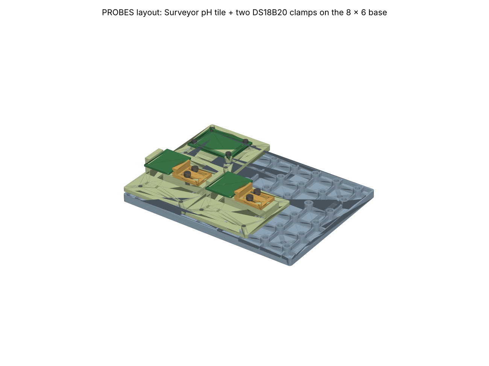
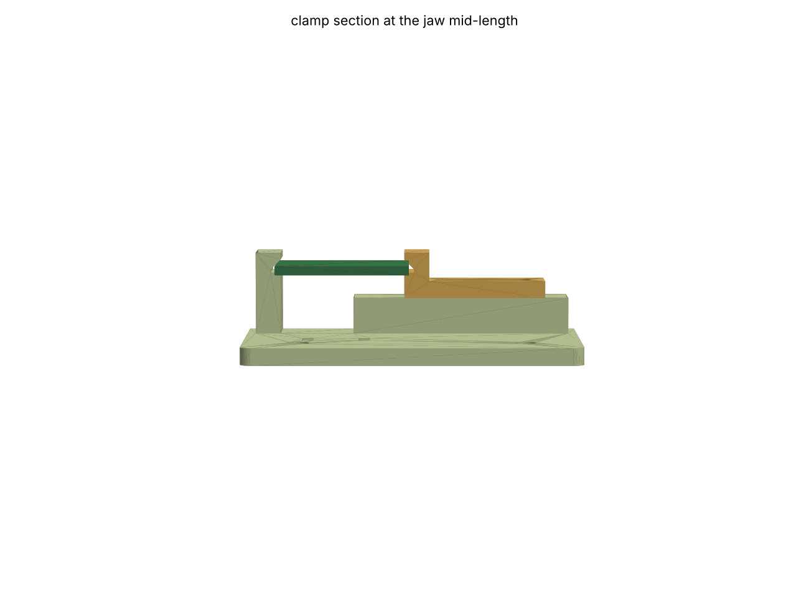

# module_grid

A 20 mm grid for building up electronics and sensor layouts out of printed
tiles. The base has an M3 heat-set insert bore at every cell centre. A tile is
n × m cells with an M3 hole at the centre of each corner cell, so any tile
screws to any base at any cell. Fit inserts only where a tile lands. Not
printed yet.



## Status

STATUS is `passes` (2026-10-15). Built and checked:
- `B8x6` base: 160 × 120 × 9.4, 48 insert bores (4.0 × 8.2) in 7.2 bosses,
  ribs on the cell-centre lines with 3 mm under the tiles for jumpers, four
  #8 / M4 wall-screw holes at grid nodes under the tiles.
- `SURVEYOR_PH_tile` (in `standoff_plate`, `mount=dict(..., grid=True)`):
  Atlas Surveyor pH on M2.5 bosses with captured nuts, 3 × 3 cells,
  M3 × 12 to the base. Its SMA reaches 0.5 past the tile at -X: put that end
  at a base edge or beside a free cell.
- `DS18B20` edge clamp, 3 × 3 cells, M3 × 10 to the base. It is for generic
  DS18B20 screw-terminal adapters, whose outline and holes nobody publishes.
  A fixed jaw and a sliding jaw grip two opposite edges of any board 16–28 wide
  and 1.0–1.7 thick. The sliding jaw rides on two M3 × 10 screws in heat-set
  inserts. The 45° groove roofs press the board's edges down onto the groove
  floors. Zip-tie slots on the -Y end anchor the probe cable.
- `PROBES` layout: the Surveyor tile and two clamps on `B8x6`. All 15 bodies
  checked pairwise; every tile hole lands on an insert. 12 inserts to fit.

Fasteners: heat-set inserts where a joint is made and unmade (tile to base,
the clamp jaw); captured nuts stay for M2 / M2.5 board screws, which no M3
insert takes. Mount the tiles before the clamped boards: a board may overhang a
tile's base screw.

UNVERIFIED: the DS18B20 boards' thickness range and a bare 1.5 mm strip along
each gripped edge (top and underside); tails under the board within 3.5.



## Sources

M3 screws ISO 4762; insert bore 4.0 and length 5.7 are the CNC Kitchen /
Ruthex standard M3 insert (`cacad.registries.materials`). If your inserts
differ, change that row. Clearance bores are ISO 273 medium + the DESIGN FDM
allowance. The 20 mm pitch is the 2020 extrusion module (DESIGN). The
DS18B20 adapter outlines (24 × 21, sigmanortec.ro; Adafruit's extender
25.3 × 18.0) only size the clamp's range; the clamp depends on no hole. The
Surveyor comes from `cacad/registries/boards.py` (Atlas datasheet + STEP).

## Layout

```
params.py     GRID, M3, INSERT, BASES, CLAMPS, LAYOUTS; insert_bore_depth / insert_screw (one bore
              depth, a stocked screw for every clamp 2.0..6.2), derive/validate for each
base.py       build_base, check_base (hand volume, probes)
clamp.py      build_tile, build_jaw, build_hardware (board, tails, screws, driver columns), check_clamp
              at both ends of the width and thickness ranges
assembly.py   build_layout, check_layout (pairwise), STEP + a 3MF per bed
```

## Run

```
.venv/bin/python projects/module_grid/params.py      # prints the design
.venv/bin/python projects/module_grid/base.py        # -> out/module_grid_base_*.step, .stl
.venv/bin/python projects/module_grid/clamp.py       # -> out/module_grid_clamp_*
.venv/bin/python projects/standoff_plate/plate.py    # includes SURVEYOR_PH_tile
.venv/bin/python projects/module_grid/assembly.py    # -> out/*_assembly.step, *_bed1_base.3mf, *_bed2_tiles.3mf
.venv/bin/python -m pytest projects/module_grid
```
