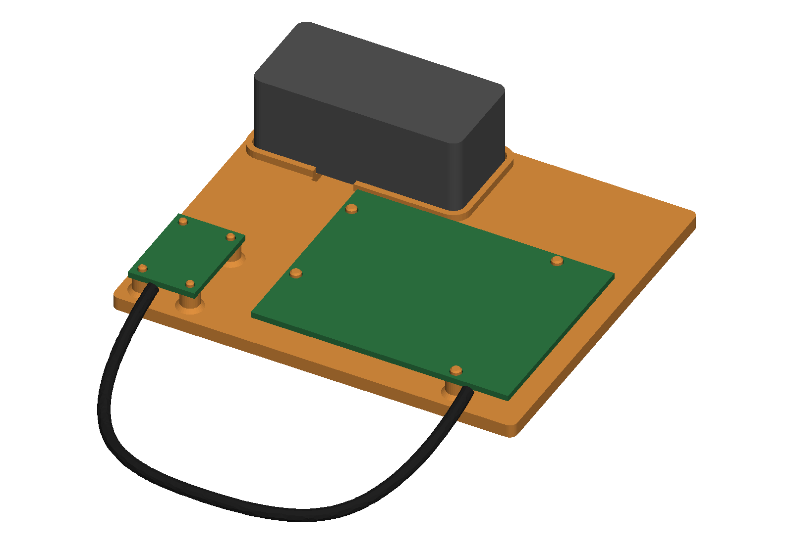
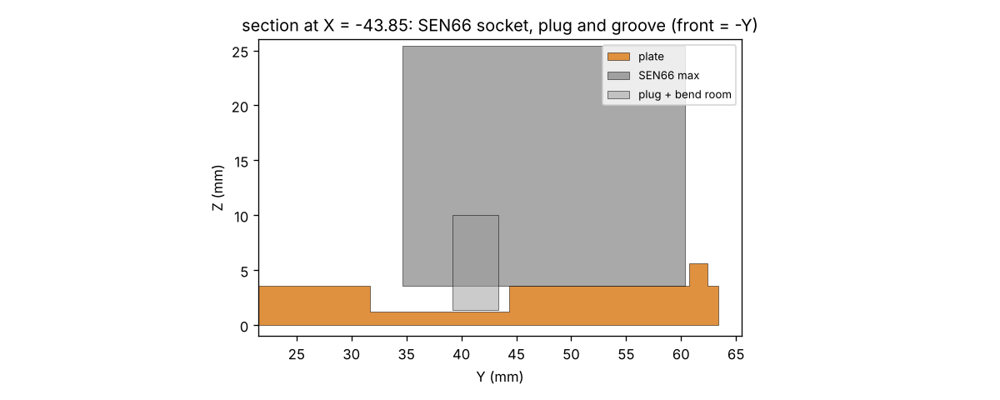
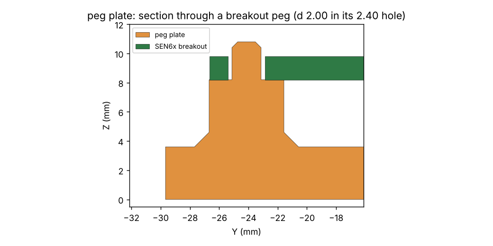

# sen66_bench

An open PETG plate for a first SEN66 test, in two versions. It holds an
Adafruit Metro ESP32-S3, the Adafruit SEN6x breakout (PID 6331) and the SEN66,
which has no mounting holes and drops into a 2 mm lip. Not an enclosure. Not
printed yet.

| `SEN66_BENCH` (M2 screws, captured nuts) | `SEN66_BENCH_PEG` (no screws) |
|---|---|
|  |  |

Both are 107.4 × 93.0. The breakout and the Metro sit in the front row, and the
SEN66 sits behind the Metro. The two STEMMA QT plugs face the front edge, 84 mm
apart, as on the owner's bench. Any STEMMA QT cable of 162 mm or more hangs off
that edge in a U, with no side load on either plug. The Metro's USB-C and DC
jack face the right edge. Its battery JST and microSD have 15 mm of open plate,
and its rear headers 8 mm. The SEN66's GH plug hangs to 0.74 mm above the
sensor's bottom. A 2.4 mm groove under it gives the wires room to turn, and
leads them out past the lip. From there the GH cable runs behind the breakout to
its GH, which faces the left edge (about 110 mm of cable). Plug the GH cable into
the sensor before you set it in the lip. The lip stays under the outlet arches.

**No screws:** each boss carries a plain peg, 2.8 mm in the Metro's 3.2 holes
and 2.0 mm in the breakout's plated 2.5 holes, 1 mm proud. The boards drop on and
cannot slide or turn, but nothing holds them down. Steady a board while you pull
a plug. Snap pins are not offered: in the breakout's holes their prongs would be
0.6–1.0 mm thick, under the repo's 1.2 mm minimum wall.




## Status

STATUS is `passes`. Each version is one solid whose volume matches the hand
calculation, with no overhang beyond the screw plate's nut-pocket bridges.
- Screws: 4.0 plate, boards at 8.8, 8 × M2 × 10 ISO 4762 + 8 × M2 ISO 4032 nuts.
- Pegs: 3.6 plate, boards at 8.2, 10.8 overall.
UNVERIFIED: board thickness 1.6, plating 0.1 off the breakout's drill, and how
far the breakout's GH mouth stands past its edge (1.0). The GH cable length is
an estimate. Nothing is checked against Adafruit's STEP models yet.

## Sources

Board outlines, holes, pin keepouts and connectors come from Adafruit's Eagle
files (`Adafruit Metro ESP32-S3 Rev B.brd`, `Adafruit SEN6x Breakout.brd`) via
`tools/board_from_eagle.py`, in `cacad/registries/boards.py`. The layout and the
screw plate are `projects/standoff_plate` row `SEN66_BENCH`. Sensor, arch,
socket, plug and groove depth are `projects/sen6x_enclosure`'s (Sensirion
datasheet and STEP, JST eGH). Peg clearance is ISO 273 fine + the DESIGN FDM
allowance; the lip fit is `materials.FIT_CLEAR`. Placements are DESIGN, and
`validate()` holds every relation they rely on.

## Run

```
.venv/bin/python projects/sen66_bench/params.py          # prints both designs
.venv/bin/python projects/sen66_bench/sen66_bench.py     # -> out/*.step, *.stl, *.3mf
.venv/bin/python -m pytest projects/sen66_bench
```
