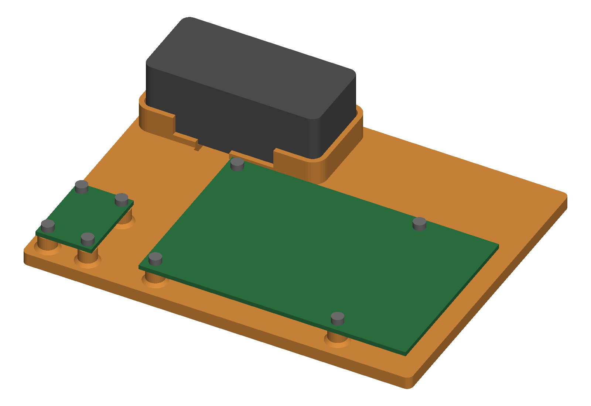
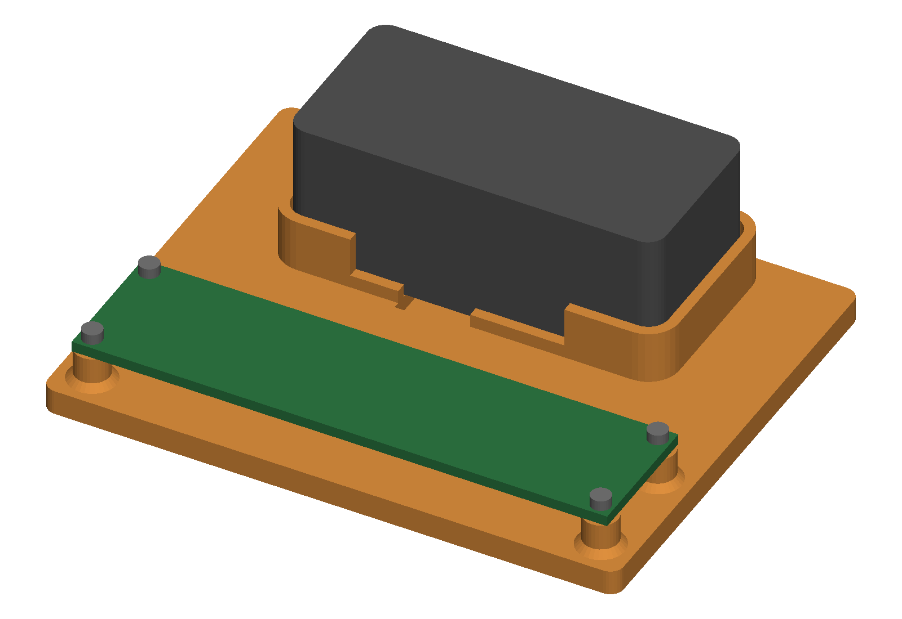

# sen66_bench

Open PETG plates for testing a Sensirion SEN66. Each holds the SEN66, which has
no mounting holes, in a lip, plus the boards that read it, on printed bosses.
Not enclosures.

| Variant | Boards | Fixing | Plate |
|---|---|---|---|
| `SEN66_BENCH` | Metro ESP32-S3 + SEN6x breakout | 8 × M2 × 10 + nuts | 107.4 × 93.0 |
| `SEN66_BENCH_PEG` | the same | no screws: locating pegs | 107.4 × 93.0 |
| `SEN66_PI` | Raspberry Pi 4B + SEN6x breakout | 8 × M2 × 10 + nuts | 123.8 × 95.7 |
| `SEN66_PERF` | Adafruit 2 × 8 cm proto-board | 4 × M1.6 × 10 + nuts | 86.0 × 68.7 |

| Metro | Pi 4B | Proto-board |
|---|---|---|
|  |  |  |

**The lip.** Along the long sides it is 2 mm, under the outlet arches. Beyond
the arches it rises to 8 mm round both ends, so the twisted GH cable cannot turn
or tip the sensor. The sensor stays a free fit (0.4 all round). A 2.4 mm groove
under the GH socket gives the plug's wires room to turn and leads them out past
the front lip. Plug the GH cable into the sensor before you set it in.

**Metro / peg.** The two STEMMA QT plugs face the front edge, 84 mm apart, so a
cable of 162 mm or more hangs off it in a U. USB-C and DC jack face the right
edge. The peg version's boards drop onto plain pegs and lift off: steady a
board while you pull a plug. Snap pins would be under the 1.2 mm minimum wall.

**Pi 4B.** USB-C/HDMI/audio face the front edge, USB-A/Ethernet the right. The
microSD end has 15 mm, the GPIO side 8 mm. The breakout's rear STEMMA QT feeds
GPIO pins 1/3/5/6 (3V3, SDA, SCL, GND) through a STEMMA QT to female-socket
cable. One M2 size: the breakout's plated holes refuse M2.5.

**Proto-board.** It holds the 2 × 8 cm board and the SEN66, with 17 mm behind
the board for a GH plug. Its 2.0 mm holes refuse M2 (ISO 273), hence M1.6.
A XIAO cannot be soldered onto it: its pin rows are 15.24 apart, the board's six
rows span 12.7.

## Status

STATUS is `passes`: every variant is one solid whose volume matches the hand
calculation, with no overhang beyond the nut-pocket bridges. The owner found the
twisted GH cable moves the sensor in a 2 mm lip (2026-10-24); the tall ends
answer that, and no print has confirmed them. UNVERIFIED: board thickness (1.6; Pi 1.4),
the proto-board's grid position and pads, plating 0.1, the breakout's GH mouth
(1.0 past its edge), cable lengths. No vendor STEP checks yet.

## Sources

Metro and breakout: Adafruit's Eagle files via `tools/board_from_eagle.py`. Pi
4B: Raspberry Pi's mechanical drawing and HAT spec. Proto-board: Adafruit 4783
technical details (2 mm holes, 76 × 16, 6 × 28 at 2.54). All in
`cacad/registries/boards.py`. Layouts and screw plates: `projects/standoff_plate`
rows of the same names. Sensor, arch, socket, plug, groove:
`projects/sen6x_enclosure` (Sensirion datasheet and STEP, JST eGH). Fits: ISO 273
+ the DESIGN FDM allowance, `materials.FIT_CLEAR`. Placements are DESIGN, and
`validate()` holds every relation they rely on.

## Run

```
.venv/bin/python projects/sen66_bench/params.py          # prints every variant
.venv/bin/python projects/sen66_bench/sen66_bench.py     # -> out/*.step, *.stl, *.3mf
.venv/bin/python -m pytest projects/sen66_bench
```
