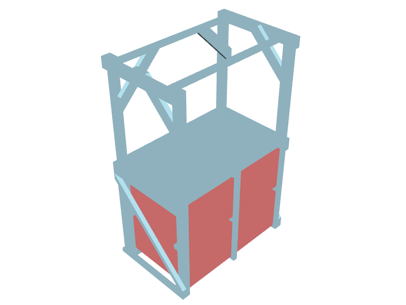

# Tote bench

A workbench that stores four HDX 27 gal totes (two columns, two levels) under
a 23/32 in plywood top at standing height, with an open 2x4 frame on up to
72 in, braced by four 45 deg knee braces. Built mostly from lumber already on
hand: four 72 in 2x4 legs, four 31 in 2x4s (the side rails, trimmed), four
45 deg braces and eight 2x2s; one 2x4, one 4 x 8 plywood sheet, screws and two L-brackets are
bought. Lumber, not a print: the manufacturability layer is the cut plan
against the inventory and each joint's screw against the stocked ladder.



## Status

STATUS is `concept`: modelled and checked (no overlaps, totes clear everything
and sit on both rungs and both runners, every modelled screw bites its member,
touches nothing else and can be driven), nothing cut beyond what is on hand.
An independent review found two blocking defects, both fixed: the totes had
nothing under the 19-5/8 in between the rungs while sliding (now 2x2 runners),
and nothing braced the bench side to side below the top (now a plywood back
panel, which is also the totes' full-height stop). Open, from that review:
screws sit 1/2-1 in from the 2x2 ends (glue is required, pilot every hole);
the side braces' lower ends are toe-screwed and the back braces' tops take one
end-grain screw; the braces are assumed cut as trapezoids (both 45s converging).
The FreeCAD view is written but not yet run against FreeCAD.

## Sources

- Lumber: ALSC PS 20 dressed sizes (2x4 = 1-1/2 x 3-1/2, 2x2 = 1-1/2 square).
- Plywood: US DOC PS 1, 23/32 Performance Category (sold as 3/4 in).
- Screws: ASME B18.6.1 #8 wood screw shank; 6D penetration from AWC NDS 2018.
- Rungs: SPF No.2 design values from the NDS 2018 Supplement, Table 4A.
- HDX 27 gal Tough Storage Tote: exterior at top and interior at bottom from
  `cacad.registries.reservoirs.HDX_27GAL` (homedepot.com 999-27G-HDX page);
  75 lb capacity from the listing at
  https://slickdeals.net/f/18829045-hdx-27-gal-tough-storage-tote-6-97-store-pick-up-at-home-depot
- UNVERIFIED: the brace lengths (18-24 in long point; every brace check runs at
  both ends) and the 2x2 length (taken as the 8 ft they are sold in).

## Layout

```
params.py        LUMBER, TOTE, SCREW, SPF (sourced), INVENTORY (on hand), DESIGN; derive() places every board,
                 prism, tote and screw, plans the cuts and the shopping; validate() refuses anything not buildable
bench.py         build_bench (one solid per board, brace, diagonal, the notched top), build_totes, build_screws,
                 check_bench (geometry, load-path probes, totes on both rungs, every screw bites and hits nothing)
freecad_view.py  STEP -> FreeCAD document, translucent totes (FreeCAD open, MCP Addon RPC server started)
build_sheet.py   out/build_sheet.md: cut list, layout marks from the floor, assembly order, screws, shopping,
                 open issues (screw-access conflicts found from the model)
tests/           geometry + function, sources, inventory, braces over the range, bearing, build sheet
```

## Run

```
.venv/bin/python projects/tote_bench/params.py         # design, cut plan against inventory, shopping list
.venv/bin/python projects/tote_bench/bench.py          # build + checks -> out/tote_bench.step, .stl (+ _totes)
.venv/bin/python projects/tote_bench/build_sheet.py    # -> out/build_sheet.md
.venv/bin/python projects/tote_bench/freecad_view.py   # FreeCAD open, MCP Addon RPC server started
.venv/bin/python -m pytest projects/tote_bench -q
```

## Why the totes sit on rungs

Hanging a tote by its rim on a 1-1/2 in 2x2 rail would need the rim to stand
about 1-3/8 in proud of the wall, and HDX does not publish that. Sitting the
tote on its bottom across a front and a back rung uses only published
numbers: width and length at the top, height with lid, interior bottom length.

## Why the 31s are trimmed

At 31 in deep the tote, pushed back to its stop, puts the front of its bottom
past the front rung: it misses it. Trimmed to 29-5/8 in it bears on both
rungs (`test_untrimmed_31s_fail_on_bearing`).
